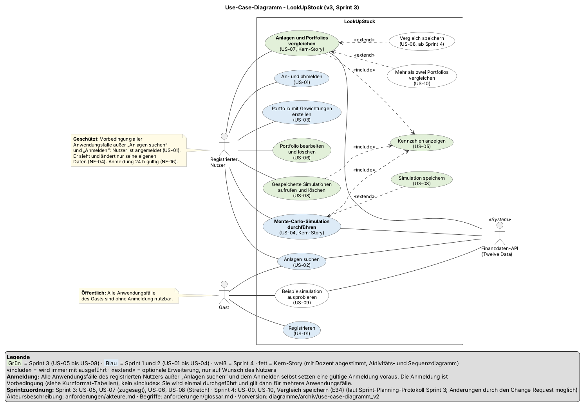
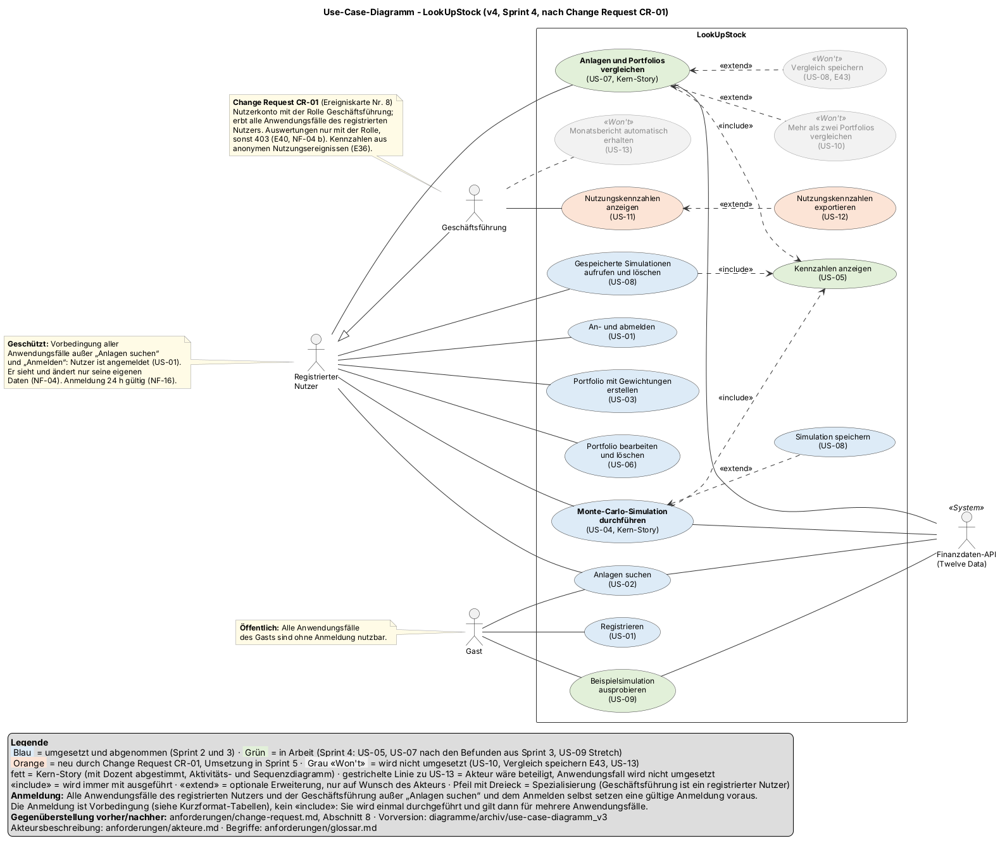

# Change Request CR-01 – Reporting für die Geschäftsführung

| | |
|---|---|
| **Projekt** | LookUpStock |
| **Issue** | Docs #131 Auswirkungsanalyse, Entscheidung, Product Backlog vorher und nachher (Ereigniskarte: Docs #114) |
| **Verantwortlich** | Mert Eminel (KujoBaraka), Product Owner |
| **Version** | 1 |
| **Stand** | 25.10.2026 |
| **Grundlagen** | Aufgabenbeschreibung Kapitel III.1 (Change Request), Ereigniskarte Nr. 8 „Reporting für die Geschäftsführung“, Product Backlog (Stand 02.10.2026), Sprint-Planning-Protokoll Sprint 4 (Abschnitte 2, 7, 9, 10), Abnahmeprotokolle Sprint 2 und Sprint 3, Akteursbeschreibung v3, NFRs Version 3, ER-Diagramm v4, Klassendiagramm v4, API-Design (Stand 25.10.2026), ADR-04, ADR-06 |
| **KI-Nutzung** | Entwurf mit KI-Unterstützung erstellt und vom Product Owner geprüft, siehe KI-Log |

Dieses Dokument beschreibt den Change Request aus der Ereigniskarte und den Umgang des Teams damit. Es folgt den fünf Schritten aus Kapitel III.1 der Aufgabenbeschreibung: Dokumentation (Abschnitt 1), Impact-Analyse (Abschnitte 2 bis 4), Entscheidung mit dem Product Owner (Abschnitt 5), Nachvollziehbarkeit mit Product Backlog vorher und nachher und Change Log (Abschnitte 6 bis 8). Die Reflexion folgt in der Retrospektive (Abschnitt 9).

Die fachlichen Festlegungen, Kurzformat-Tabellen und Akzeptanzkriterien der neuen Stories stehen in `kurzformat_sprint-4.md` (Festlegungen E36 bis E43).

---

## 1. Dokumentation des Change Requests

| Feld | Inhalt |
|---|---|
| **ID** | CR-01 |
| **Titel** | Reporting für die Geschäftsführung |
| **Beschreibung (laut Ereigniskarte)** | Die Geschäftsführung verlangt monatliche Auswertungen und Kennzahlen zur Nutzung des Systems, als Dashboard und als exportierbare Datei. |
| **Betroffen (laut Ereigniskarte)** | Functional, Datenbasis |
| **Auslöser** | Neue Anforderung der Geschäftsführung des Betreibers von LookUpStock. Im Projekt übergeben als Ereigniskarte Nr. 8 durch den Dozenten bei der Zwischenpräsentation am 23.10.2026. |
| **Eingang** | 23.10.2026 (Freitag, Zwischenpräsentation) |
| **Analyse und Entscheidung** | 25.10.2026 (Sprint 4) |
| **Betroffene Stakeholder** | • **Geschäftsführung** (neu): Auftraggeberin der Änderung, künftige Nutzerin des Dashboards • **Product Owner** (zugleich Kunde): Analyse, Priorisierung, Entscheidung • **Entwicklungsteam**: Umsetzung in Backend und Frontend, Anpassung der Diagramme und Tests • **Registrierte Nutzer und Gäste**: Ihre Nutzung wird künftig gezählt; Datenschutz muss gewahrt bleiben (NF-14 b) • **Dozent**: Bewertung des Umgangs mit der Änderung |

### Präzisierung durch den Product Owner

Die Ereigniskarte lässt offen, **welche** Kennzahlen gemeint sind. Der Product Owner präzisiert die Anforderung so (Details in `kurzformat_sprint-4.md`, E36 bis E42):

- **Nutzung** heißt: Wie oft wurden die Funktionen von LookUpStock in einem Monat erfolgreich verwendet? Gezählt werden Registrierungen, Anmeldungen, angelegte Portfolios, durchgeführte und gespeicherte Simulationen, Vergleiche, Beispielsimulationen von Gästen und Anlagensuchen. Dazu kommt die Zahl der Nutzerkonten am Monatsende.
- **Monatlich** heißt: Die Auswertung bezieht sich immer auf einen Kalendermonat, den die Geschäftsführung auswählt. Ein automatischer Versand ist nicht gemeint.
- **Dashboard** heißt: eine eigene Seite, die nur die Geschäftsführung aufrufen kann.
- **Exportierbare Datei** heißt: eine CSV-Datei mit denselben Werten, die sich in Excel öffnen lässt.

---

## 2. Ist-Analyse der Datenbasis

Die Karte nennt ausdrücklich die Datenbasis. Die Prüfung der Migrationen V1 bis V7 (ER-Diagramm v4) zeigt, welche Kennzahlen heute schon ableitbar wären:

| Kennzahl | Heute ableitbar? | Begründung |
|---|---|---|
| Neue Registrierungen | ja | `app_user.created_at` |
| Nutzerkonten am Monatsende | ja | `app_user.created_at`; Konten werden nicht gelöscht |
| Angelegte Portfolios | nur teilweise | `portfolio.created_at`; gelöschte Portfolios (US-06) fehlen |
| Gespeicherte Simulationen | nur teilweise | `simulation.created_at`; gelöschte Simulationen und Simulationen gelöschter Portfolios (E28) fehlen |
| Anmeldungen | nein | `auth_token` wird beim Abmelden gelöscht (ADR-04) |
| Durchgeführte Simulationen | nein | Nur gespeicherte Simulationen werden abgelegt (US-08) |
| Durchgeführte Vergleiche | nein | Vergleiche werden nicht gespeichert (E34) |
| Beispielsimulationen (Gäste) | nein | Nichts wird gespeichert (US-09) |
| Anlagensuchen | nein | Der Suchcache liegt nur im Arbeitsspeicher (BE #77) |

**Ergebnis:** Für sechs von neun Kennzahlen fehlt die Datenbasis vollständig oder teilweise. Das System muss die Nutzung künftig **selbst erfassen**. Rückwirkende Auswertungen für die Zeit vor der Einführung sind deshalb nicht möglich.

**Datenschutz:** NF-14 b erlaubt als personenbezogene Daten nur E-Mail-Adresse und Passwort-Hash. Eine Erfassung mit Nutzerbezug (wer hat wann was getan) würde dem widersprechen. Die Nutzung wird deshalb **anonym** erfasst: nur Art und Zeitpunkt des Ereignisses, ohne Nutzer, IP-Adresse, Suchbegriff oder Anlage (E36). Kennzahlen, die einen Nutzerbezug brauchen (z. B. „aktive Nutzer“), entfallen; als Annäherung dient die Zahl der Anmeldungen.

---

## 3. Impact-Analyse

### 3.1 Anforderungen und User Stories

| Artefakt | Auswirkung |
|---|---|
| Product Backlog | Neu: US-11 Nutzungskennzahlen als Dashboard, US-12 Export als CSV-Datei, US-13 automatischer Monatsbericht (Won't). Umpriorisierung: Rest von US-08 „Vergleiche speichern“ auf Won't (Abschnitt 6 und 7) |
| Akteure | Neuer primärer Akteur **Geschäftsführung** (Akteursbeschreibung v4, Docs #141) |
| Kurzformat-Tabellen | Neu: `kurzformat_sprint-4.md` mit US-11, US-12 und den Festlegungen E36 bis E43 |
| US-01 Registrieren und anmelden | Registrierung und Anmeldung werden zusätzlich als Ereignis gezählt; für den Nutzer ändert sich nichts. Ein Nutzerkonto kann die Rolle Geschäftsführung tragen (E40) |
| US-02, US-03, US-04, US-07, US-08, US-09 | Erfolgreiche Suche, Portfolio-Anlage, Simulation, Speicherung, Vergleich und Beispielsimulation werden zusätzlich als Ereignis gezählt (E37); für den Nutzer ändert sich nichts |
| US-08 Simulationen und Vergleiche speichern | Rest „Vergleiche speichern“ (E34) wird zugunsten des Change Requests auf Won't gesetzt (E43) |
| NFRs | NF-04 um die Rollenprüfung für Auswertungen erweitert; NF-14 b präzisiert (Nutzungsereignisse ohne Personenbezug); NFRs Version 4 |
| Glossar | Neu: Dashboard, CSV-Export, Geschäftsführung, Nutzungsereignis, Nutzungskennzahlen, Rolle (Glossar Version 6) |

### 3.2 Use-Cases und Diagramme

| Diagramm | Auswirkung | Zeitpunkt |
|---|---|---|
| Use-Case-Diagramm | Neuer Akteur Geschäftsführung mit den Anwendungsfällen „Nutzungskennzahlen anzeigen“ und „Nutzungskennzahlen exportieren“ (`<<extend>>`). **Gegenüberstellung vorher (v3) und nachher (v4)** laut III.1.4 | Sprint 4, Docs #141 |
| Domänenmodell | Neuer Fachbegriff Nutzungsereignis (ohne Beziehung zum Nutzer); Nutzer erhält eine Rolle | Sprint 5, mit der Umsetzung |
| ER-Diagramm | Neue Tabelle für Nutzungsereignisse (ohne Fremdschlüssel auf `app_user`); neue Spalte für die Rolle in `app_user` | Sprint 5, mit der Migration |
| Klassendiagramm | Neue Klassen für das Erfassen und Auswerten der Ereignisse, neuer Controller mit Rollenprüfung | Sprint 5, mit der Umsetzung |
| Aktivitäts- und Sequenzdiagramme US-04, US-07 | Inhaltlich nicht betroffen; das Zählen nach erfolgreicher Berechnung ist ein technisches Detail und wird nicht dargestellt | – |

### 3.3 Codebestandteile

Vorschlag für die Umsetzung. Die technischen Details entscheidet das Backend-Team mit dem Code-Kontext selbst; der Product Owner übernimmt die umgesetzten Regeln danach in die Festlegungen.

| Bereich | Auswirkung |
|---|---|
| Datenbank | Migration für die Tabelle der Nutzungsereignisse (Ereignisart, Zeitpunkt) und die Rolle im Nutzerkonto. V8 ist für die Verlängerung von `mic_code` vorgesehen (BE #97), daher voraussichtlich V9 |
| Backend, Erfassung | Ein zentraler Dienst zählt erfolgreiche Aktionen an den Stellen, an denen sie abgeschlossen werden: `AuthService` (Registrieren, Anmelden), `PortfolioService` (Anlegen), `SimulationService` und `SavedSimulationService` (Simulieren, Speichern), `ComparisonService` (Vergleich), Beispielsimulation (US-09, BE #93), `AssetService` (Suche) |
| Backend, Auswertung | Auswertung je Kalendermonat; Endpunkt für die Kennzahlen als JSON und für die CSV-Datei; Rollenprüfung (403 bei fehlender Rolle). Die zentrale Anmeldung aus ADR-06 (`CurrentUserArgumentResolver`) ist dafür die Grundlage |
| Frontend | Neue Seite für das Dashboard (Monat wählen, Kennzahlen als Tabelle, Button für den Export); Navigationseintrag nur für die Rolle Geschäftsführung |
| API-Design | Neuer Abschnitt „Auswertungen“ mit Pfaden, Parametern, Antwort, CSV-Format und Fehlern (401, 403, 400) |

### 3.4 Tests

| Bereich | Auswirkung |
|---|---|
| Unit-Tests | Zählen je Ereignisart, Auswertung je Monat mit fester Uhr (Monatsgrenzen in Europe/Berlin), CSV-Format, Ablehnung von Monaten vor Erfassungsbeginn |
| Controller-Tests | 401 ohne Anmeldung, 403 ohne Rolle, 200 mit Rolle; Download mit richtigem Content-Type und Dateinamen |
| Bestehende Tests | Unverändert grün; das Zählen darf keine bestehende Antwort verändern |
| Abnahmetestfälle | Neu: AT-11-xx und AT-12-xx in den Abnahmetestfällen Sprint 5; Testkonzept Version 5 |
| NF-01 | Das Zählen geschieht nach der Berechnung und fließt nicht in `runtimeMs` ein; Nachmessung im Abnahmetest |

---

## 4. Aufwand und Risiken

### 4.1 Aufwandsschätzung

Die Schätzung enthält den Aufschlag von 50 % auf neue Aufgabentypen aus dem Sprint-Planning-Protokoll Sprint 4 (Abschnitt 10) für Backend und Frontend, weil das Team Rollenprüfung, Ereigniserfassung und Datei-Export noch nicht umgesetzt hat.

| Bereich | Aufgabe | Basis (h) | Mit Aufschlag (h) |
|---|---|---|---|
| Backend | Migration (Ereignisse, Rolle) | 0,5 | 1 |
| Backend | Ereignisse an 8 Stellen erfassen, inkl. Tests | 2 | 3 |
| Backend | Auswertung je Monat, Endpunkt, Rollenprüfung, inkl. Tests | 2,5 | 3,5 |
| Backend | CSV-Export, inkl. Test | 1 | 1,5 |
| Frontend | Dashboard-Seite, Monatsauswahl, Navigation nach Rolle, inkl. Tests | 2,5 | 3,5 |
| Frontend | Export-Button und Download | 0,5 | 1 |
| Docs | Change Request, Kurzformat, Glossar, NFRs (dieses Issue) | 3 | 3 |
| Docs | Use-Case-Diagramm v4, Akteure v4 | 1 | 1 |
| Docs | API-Design, Domänenmodell v5, ER-Diagramm v5, Klassendiagramm v5 | 2,5 | 2,5 |
| Docs | Abnahmetestfälle, Testkonzept, Abnahme | 2 | 2 |
| **Summe Teilumsetzung** (Entscheidung, Abschnitt 5) | | **17,5** | **22** |
| zusätzlich bei vollständiger Umsetzung | Automatischer monatlicher Versand (Zeitsteuerung, E-Mail-Dienst, Empfängerverwaltung), Diagramme über mehrere Monate | 5 | 7,5 |
| **Summe vollständige Umsetzung** | | **22,5** | **29,5** |

**Story Points:** US-11 5, US-12 2, US-13 3.

Reserviert waren im Sprint 4 nur 6,5 Stunden (3 h Analyse beim Product Owner, 3,5 h Umsetzung bei Pixxels02, BE #92). Die Umsetzung passt damit nicht mehr in Sprint 4, der am 25.10.2026 endet.

### 4.2 Risiken

| Risiko | Auswirkung | Gegenmaßnahme |
|---|---|---|
| Kapazität in Sprint 5 | Sprint 5 enthält bereits die Themen der Webprogrammierung (Abgabe 08.11.2026), die Befunde aus Sprint 4, Retrospektive und Gesamtdokumentation. Eine vollständige Umsetzung würde diese Themen gefährden | Teilumsetzung mit kleinem Schnitt; US-12 (Should) entfällt zuerst; Rest von US-08 wird auf Won't gesetzt (E43) |
| Datenschutz | Eine Erfassung mit Nutzerbezug würde NF-14 b verletzen | Anonyme Erfassung ohne Nutzer, IP-Adresse, Suchbegriff und Anlage (E36) |
| Keine Daten vor der Einführung | Für frühere Monate gibt es keine Werte; die Geschäftsführung könnte Nullwerte falsch deuten | Monate vor Erfassungsbeginn werden mit einer Meldung abgelehnt, statt 0 anzuzeigen (E38) |
| Zählfehler | Doppelt oder gar nicht gezählte Aktionen verfälschen die Kennzahlen | Zählen an einer zentralen Stelle je Aktion, nur nach Erfolg (E37); Unit-Test je Ereignisart |
| Aufteilung in getrennte Dienste (ADR-07) | Ereignisse entstehen künftig in mehreren Diensten | Im Sprint-5-Planning bei ADR-07 berücksichtigen (offener Punkt, Abschnitt 5.3) |
| Unbefugter Zugriff auf Unternehmenszahlen | Kennzahlen sind nur für die Geschäftsführung bestimmt | Rollenprüfung im Backend (403), nicht nur ausgeblendeter Link im Frontend (E40, NF-04) |
| Rollenvergabe ohne Oberfläche | Die Rolle muss vom Team gesetzt werden | Vergabe per Konfiguration bzw. Datenbank, im README dokumentiert; eine Rollenverwaltung ist bewusst Won't (E42) |

---

## 5. Entscheidung mit dem Product Owner

### 5.1 Betrachtete Optionen

| Option | Inhalt | Bewertung |
|---|---|---|
| **A: vollständig umsetzen** | Erfassung, Dashboard mit Diagrammen über mehrere Monate, CSV-Export, automatischer monatlicher Versand | + erfüllt die Karte wörtlich – rund 29,5 h, mehr als die Hälfte der Kapazität von Sprint 5 – gefährdet die Abgabe der Webprogrammierung am 08.11.2026 – E-Mail-Versand braucht einen zusätzlichen externen Dienst |
| **B: teilweise umsetzen** | Anonyme Erfassung, Monatskennzahlen als Dashboard (US-11), CSV-Export (US-12); kein automatischer Versand | + deckt den Kern der Karte ab: monatliche Kennzahlen, Dashboard, exportierbare Datei + rund 22 h, durch Umpriorisierung in Sprint 5 machbar + schafft die fehlende Datenbasis, auf der später erweitert werden kann – kein automatischer Versand, keine Zeitreihen |
| **C: verschieben** | Nur Analyse, Umsetzung nach Projektende | + keine Belastung von Sprint 5 – die Geschäftsführung erhält im Projekt keine Auswertung – jeder Monat ohne Erfassung fehlt später unwiderruflich in den Daten |
| **D: ablehnen** | Keine Umsetzung | – nicht begründbar: Die Anforderung ist berechtigt, die Geschäftsführung braucht die Zahlen zur Steuerung des Produkts |

### 5.2 Entscheidung

| | |
|---|---|
| **Entscheidung** | **Option B: teilweise umsetzen** |
| **Datum** | 25.10.2026 |
| **Entschieden von** | Mert Eminel, Product Owner (zugleich Kunde) |
| **Umfang** | US-11 Nutzungskennzahlen als Dashboard (Must) und US-12 Export als CSV-Datei (Should) in Sprint 5. US-13 automatischer Monatsbericht: Won't |
| **Umpriorisierung** | Rest von US-08 „Vergleiche speichern“ (E34): von „Sprint 5“ auf Won't (E43). Der Vergleich selbst (US-07) bleibt vollständig erhalten |
| **Begründung** | • Der Kern der Karte (monatliche Kennzahlen, Dashboard, exportierbare Datei) wird erfüllt. • Die Erfassung muss möglichst früh beginnen, weil Daten vor dem Start nicht nachträglich entstehen können. Verschieben (C) hätte genau diese Monate gekostet. • Der automatische Versand bringt gegenüber dem Abruf auf Knopfdruck wenig Mehrwert, kostet aber einen externen Dienst und Zeit, die für die Webprogrammierung fehlt. • „Vergleiche speichern“ ist eine Komfortfunktion mit geringerem Nutzen als das Reporting; der Verzicht macht die Kapazität für den Change Request frei. • Scrum erlaubt diese Reaktion ohne formalen Änderungsantrag: Die neuen Einträge kommen in den Product Backlog, der Product Owner priorisiert neu. |
| **Auswirkung auf den Projektplan** | Laut Sprint-Planning-Protokoll Sprint 4 werden in Sprint 5 keine neuen User Stories begonnen (Ausnahme US-09). US-11 und US-12 sind eine bewusste zweite Ausnahme wegen des Change Requests. BE #92 (Platzhalter) wird nicht in Sprint 4 umgesetzt, sondern im Sprint-5-Planning in Tasks aufgeteilt (Vorschlag in Abschnitt 5.4) |

### 5.3 Offene Punkte für das Sprint-5-Planning

- Ob das Erfassen der Ereignisse bei der Aufteilung in getrennte Dienste (ADR-07) in einem eigenen Dienst gebündelt wird, entscheidet das Team mit ADR-07.
- Wer im Team das Konto mit der Rolle Geschäftsführung für die Abnahme einrichtet.

### 5.4 Vorschlag zur Aufteilung von BE #92 und Folge-Tasks

Die Issues werden im Sprint-5-Planning angelegt; Zuordnung und Schätzung legt das Team dort fest.

| Repo | Task | Story | Std. (mit Aufschlag) |
|---|---|---|---|
| BE | Migration Nutzungsereignisse und Rolle; Ereignisse an 8 Stellen erfassen, inkl. Tests | US-11 | 4 |
| BE | Auswertung je Monat und Endpunkt mit Rollenprüfung, inkl. Tests | US-11 | 3,5 |
| BE | CSV-Export, inkl. Test | US-12 | 1,5 |
| FE | Dashboard-Seite mit Monatsauswahl, Navigation nach Rolle, inkl. Tests | US-11 | 3,5 |
| FE | Export-Button und Download | US-12 | 1 |
| Docs | API-Design Abschnitt „Auswertungen“ | US-11, US-12 | 0,5 |
| Docs | Domänenmodell v5, ER-Diagramm v5, Klassendiagramm v5 | US-11 | 2 |
| Docs | Abnahmetestfälle AT-11/AT-12, Testkonzept Version 5, Abnahme | US-11, US-12 | 2 |

---

## 6. Product Backlog vorher (Stand 25.10.2026, vor CR-01)

Grundlage: Product Backlog vom 02.10.2026, fortgeschrieben mit den Ergebnissen der Abnahmen Sprint 2 und Sprint 3 und den Entscheidungen im Sprint-Planning-Protokoll Sprint 4.

| ID | User Story | Prio | SP | Sprint | Status |
|---|---|---|---|---|---|
| US-01 | Als Nutzer möchte ich mich registrieren und anmelden, um meine Portfolios zu speichern. | Must | 3 | 2 | abgenommen (Sprint 2) |
| US-02 | Als Nutzer möchte ich Anlagen per Ticker, ISIN oder Name suchen, um sie meinem Portfolio hinzuzufügen. | Must | 2 | 1 | abgenommen (Sprint 3, Nachtest) |
| US-03 | Als Nutzer möchte ich ein Portfolio aus mehreren Anlagen mit Gewichtungen erstellen können. | Must | 5 | 1 | abgenommen (Sprint 3, Nachtest) |
| US-04 | Als Nutzer möchte ich für ein Portfolio Startkapital, Sparrate und Anlagehorizont eingeben und eine Monte-Carlo-Simulation starten, um die Bandbreite möglicher Verläufe zu sehen. | Must | 8 | 1 | abgenommen (Sprint 3, Nachtest) |
| US-05 | Als Nutzer möchte ich Kennzahlen wie Median-Endwert, Value at Risk, max. Drawdown und Zielwahrscheinlichkeit sehen, um das Risiko einzuschätzen. | Must | 2 | 3, 4 | in Arbeit (in Sprint 3 nicht abgenommen) |
| US-06 | Als Nutzer möchte ich Portfolios bearbeiten und löschen. | Should | 2 | 3 | abgenommen (Sprint 3) |
| NF-01 | Eine Simulation mit 10.000 Pfaden und bis zu 5 Anlagen dauert höchstens 3 Sekunden. | Must | 3 | 3 | nachgewiesen (Sprint 3, AT-04-14) |
| US-07 | Als Nutzer möchte ich zwei Anlagen oder Portfolios unter gleichen Annahmen vergleichen, um mich zwischen ihnen zu entscheiden. | Must | 5 | 3, 4 | in Arbeit (in Sprint 3 nicht abgenommen) |
| US-08 | Als Nutzer möchte ich Simulationen und Vergleiche speichern und später wieder aufrufen. | Should | 3 | 3, 5 | Simulationen abgenommen (Sprint 3); Vergleiche speichern offen, geplant für Sprint 5 (E34) |
| US-09 | Als Gast möchte ich ohne Konto eine Beispielsimulation ausprobieren. | Could | 1 | 4 | in Arbeit (Stretch Sprint 4) |
| US-10 | Als Nutzer möchte ich mehr als zwei Portfolios gleichzeitig vergleichen. | Won't | 8 | – | nicht umgesetzt (Sprint-Planning-Protokoll Sprint 4) |

## 7. Product Backlog nachher (Stand 25.10.2026, nach CR-01)

Geänderte und neue Einträge sind **fett** markiert. Nicht genannte Einträge sind unverändert.

| ID | User Story | Prio | SP | Sprint | Status |
|---|---|---|---|---|---|
| US-01 | Als Nutzer möchte ich mich registrieren und anmelden, um meine Portfolios zu speichern. | Must | 3 | 2 | abgenommen (Sprint 2) |
| US-02 | Als Nutzer möchte ich Anlagen per Ticker, ISIN oder Name suchen, um sie meinem Portfolio hinzuzufügen. | Must | 2 | 1 | abgenommen (Sprint 3, Nachtest) |
| US-03 | Als Nutzer möchte ich ein Portfolio aus mehreren Anlagen mit Gewichtungen erstellen können. | Must | 5 | 1 | abgenommen (Sprint 3, Nachtest) |
| US-04 | Als Nutzer möchte ich für ein Portfolio Startkapital, Sparrate und Anlagehorizont eingeben und eine Monte-Carlo-Simulation starten, um die Bandbreite möglicher Verläufe zu sehen. | Must | 8 | 1 | abgenommen (Sprint 3, Nachtest) |
| US-05 | Als Nutzer möchte ich Kennzahlen wie Median-Endwert, Value at Risk, max. Drawdown und Zielwahrscheinlichkeit sehen, um das Risiko einzuschätzen. | Must | 2 | 3, 4 | in Arbeit (in Sprint 3 nicht abgenommen) |
| US-06 | Als Nutzer möchte ich Portfolios bearbeiten und löschen. | Should | 2 | 3 | abgenommen (Sprint 3) |
| NF-01 | Eine Simulation mit 10.000 Pfaden und bis zu 5 Anlagen dauert höchstens 3 Sekunden. | Must | 3 | 3 | nachgewiesen (Sprint 3, AT-04-14) |
| US-07 | Als Nutzer möchte ich zwei Anlagen oder Portfolios unter gleichen Annahmen vergleichen, um mich zwischen ihnen zu entscheiden. | Must | 5 | 3, 4 | in Arbeit (in Sprint 3 nicht abgenommen) |
| **US-08** | Als Nutzer möchte ich **Simulationen** speichern und später wieder aufrufen. | Should | 3 | 3 | **abgenommen (Sprint 3); „Vergleiche speichern“ auf Won't (E43)** |
| US-09 | Als Gast möchte ich ohne Konto eine Beispielsimulation ausprobieren. | Could | 1 | 4 | in Arbeit (Stretch Sprint 4) |
| US-10 | Als Nutzer möchte ich mehr als zwei Portfolios gleichzeitig vergleichen. | Won't | 8 | – | nicht umgesetzt (Sprint-Planning-Protokoll Sprint 4) |
| **US-11** | **Als Geschäftsführung möchte ich monatliche Kennzahlen zur Nutzung von LookUpStock in einem Dashboard sehen, um die Entwicklung des Produkts beurteilen zu können.** | **Must** | **5** | **5** | **neu (CR-01)** |
| **US-12** | **Als Geschäftsführung möchte ich die Kennzahlen eines Monats als Datei exportieren, um sie weiterzuverarbeiten und weiterzugeben.** | **Should** | **2** | **5** | **neu (CR-01)** |
| **US-13** | **Als Geschäftsführung möchte ich den Monatsbericht automatisch zugeschickt bekommen.** | **Won't** | **3** | **–** | **neu (CR-01), nicht umgesetzt (E42)** |

### Gegenüberstellung

| Eintrag | Vorher | Nachher | Grund |
|---|---|---|---|
| US-08 | Simulationen **und Vergleiche** speichern; Vergleiche für Sprint 5 geplant | Nur Simulationen; Vergleiche speichern Won't | Kapazität für CR-01 (E43) |
| US-11 | – | Must, 5 SP, Sprint 5 | Kern von CR-01 |
| US-12 | – | Should, 2 SP, Sprint 5 | „exportierbare Datei“ aus CR-01 |
| US-13 | – | Won't, 3 SP | Automatischer Versand bewusst nicht umgesetzt (E42) |

---

## 8. Change Log der betroffenen Artefakte

| Datum | Artefakt | Version vorher → nachher | Änderung | Issue |
|---|---|---|---|---|
| 25.10.2026 | `anforderungen/change-request.md` | – → 1 | Neu: Dokumentation, Impact-Analyse, Entscheidung, Product Backlog vorher und nachher | Docs #131 |
| 25.10.2026 | `anforderungen/kurzformat_sprint-4.md` | – → 1 | Neu: Kurzformat-Tabellen US-11 und US-12, Festlegungen E36 bis E43, Akzeptanzkriterien | Docs #131 |
| 25.10.2026 | `anforderungen/glossar.md` | 5 → 6 | Neu: Dashboard, CSV-Export, Geschäftsführung, Nutzungsereignis, Nutzungskennzahlen, Rolle | Docs #131 |
| 25.10.2026 | `anforderungen/nfr_furps.md` | 3 → 4 | NF-04 um die Rollenprüfung erweitert, NF-14 b um Nutzungsereignisse präzisiert | Docs #131 |
| 25.10.2026 | `diagramme/use-case-diagramm` | v3 → v4 | Akteur Geschäftsführung, zwei neue Anwendungsfälle; **Gegenüberstellung vorher und nachher** | Docs #141 |
| 25.10.2026 | `anforderungen/akteure.md` | 3 → 4 | Neuer Akteur Geschäftsführung | Docs #141 |
| Sprint 5 | `api/api-design.md` | – | Neuer Abschnitt „Auswertungen“ | folgt |
| Sprint 5 | Domänenmodell, ER-Diagramm, Klassendiagramm | v4 → v5 | Nutzungsereignis, Rolle, neue Klassen | folgt |
| Sprint 5 | Testkonzept, Abnahmetestfälle | – | AT-11-xx, AT-12-xx | folgt |

Weitere Einträge werden bei der Umsetzung in Sprint 5 ergänzt.

### 8.1 Gegenüberstellung vorher und nachher: Use-Case-Diagramm v3 → v4

Laut III.1.4 wird für mindestens ein betroffenes Diagramm der Stand vor und nach der Änderung gegenübergestellt. Gewählt ist das Use-Case-Diagramm, weil der Change Request einen neuen Akteur und neue Anwendungsfälle einführt.

| Vorher: Use-Case-Diagramm v3 (18.10.2026) | Nachher: Use-Case-Diagramm v4 (25.10.2026) |
|---|---|
|  |  |

| Element | v3 (vorher) | v4 (nachher) | Grund |
|---|---|---|---|
| Akteure | Gast, registrierter Nutzer, Finanzdaten-API | zusätzlich **Geschäftsführung** als Spezialisierung des registrierten Nutzers | CR-01, E40 |
| Anwendungsfälle | 13 | 16: neu „Nutzungskennzahlen anzeigen“ (US-11), „Nutzungskennzahlen exportieren“ (US-12, `<<extend>>`), „Monatsbericht automatisch erhalten“ (US-13, Won't) | CR-01, Entscheidung Option B |
| „Vergleich speichern“ | geplant für Sprint 4 (E34) | Won't (grau) | E43, Umpriorisierung für CR-01 |
| „Mehr als zwei Portfolios vergleichen“ (US-10) | geplant für Sprint 4 | Won't (grau) | Sprint-Planning-Protokoll Sprint 4 |
| Farbschema | nach Sprint (Sprint 1/2, Sprint 3, Sprint 4) | nach Status (abgenommen, in Arbeit, neu durch CR-01, Won't) | Der Stand nach dem Change Request ist so auf einen Blick erkennbar |
| Übrige Anwendungsfälle und Beziehungen | – | unverändert | – |

Dateien: `diagramme/archiv/use-case-diagramm_v3.puml` und `diagramme/use-case-diagramm_v4.puml` (Docs #141).

---

## 9. Reflexion (Retrospektive)

Laut III.1.5 greift das Team in der Retrospektive auf, ob Scrum den Umgang mit der Änderung erleichtert oder erschwert hat. Die Reflexion erfolgt im Sprint Review 4 bzw. in der Retrospektive und wird dort dokumentiert (Docs #140). Ansatzpunkte aus Sicht des Product Owners:

- **Erleichtert:** Die Karte wurde ohne formalen Änderungsantrag als neue Einträge in den Product Backlog aufgenommen und neu priorisiert. Die vorab reservierte Zeit (Sprint-Planning-Protokoll Sprint 4, Abschnitt 2) hat eine sofortige Analyse ermöglicht.
- **Erschwert:** Die kurzen Sprints und der bereits volle Sprint 5 lassen wenig Spielraum; die Umsetzung musste mit dem Verzicht auf „Vergleiche speichern“ erkauft werden.
