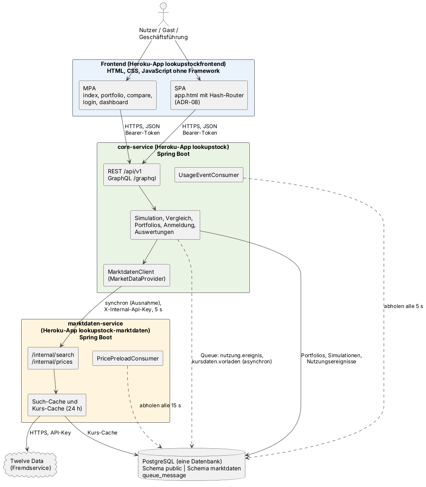

# 1 Einführung in das Projekt

## 1.1 Warum LookUpStock?

Wer einen Sparplan auf einen ETF oder ein eigenes Portfolio anlegen möchte, sieht in Vergleichsportalen meist eine einzige Zahl: die Rendite der Vergangenheit. Diese Zahl verdeckt zwei Dinge, die für eine Entscheidung wichtiger sind. Erstens ist die künftige Entwicklung unsicher; ein ungünstiger Verlauf kann deutlich unter den Einzahlungen enden. Zweitens sind Vergleiche oft unfair, weil zwei Anlagen über unterschiedliche Zeiträume oder mit unterschiedlichen Annahmen betrachtet werden.

Die Idee von LookUpStock war deshalb, die Unsicherheit sichtbar zu machen und Vergleiche fair zu gestalten. Eine Monte-Carlo-Simulation rechnet aus der Kurshistorie geschätzte Renditen und Schwankungen in Tausende möglicher Verläufe hoch und zeigt sie als Bandbreite (5., 50. und 95. Perzentil). Beim Vergleich zweier Anlagen oder Portfolios verwenden beide Seiten dieselben Zufallszahlen (Seed) und denselben Schätzzeitraum, sodass Unterschiede nur aus der Zusammensetzung entstehen.

Fachlich bietet das Thema eine echte Rechenlogik statt reiner Datenverwaltung, technisch die Anbindung eines externen Datenanbieters. Bei der Themenwahl war die Machbarkeit in fünf Wochen das wichtigste Kriterium. Als Risiko galt von Anfang an die Simulation selbst. Das Modell (`anforderungen/simulationsmodell.md`) wurde deshalb früh festgelegt und in Sprint 2 bewusst an die bereits programmierte Engine angepasst, statt die Engine neu zu schreiben (normalverteilte Monatsrenditen je Anlage, keine Korrelation). Diese Vereinfachung ist im Modell als Grenze dokumentiert.

Eine Besonderheit bestimmt den gesamten Projektverlauf: Das Projekt wird gleichzeitig in der Fallstudie Software Engineering und in der Webprogrammierung bewertet. Es gab also zwei Anforderungsquellen, die das Team im selben Backlog zusammenführen musste. Wie in Abschnitt 1.4 beschrieben, ist genau an dieser Stelle der größte Fehler des Projekts entstanden.

## 1.2 Was der Web-Service leistet

Die folgende Übersicht ist bewusst knapp; die Umsetzung beschreiben die Kapitel 3 bis 5.

- **Gäste** probieren auf der Startseite ohne Konto eine Beispielsimulation mit festen Werten aus.
- **Registrierte Nutzer** suchen Aktien und ETFs über Twelve Data, stellen gewichtete Portfolios zusammen, simulieren sie (Fächerdiagramm, Kennzahlen wie Median-Endwert, Value at Risk und Zielwahrscheinlichkeit), vergleichen zwei Einträge und speichern Simulationen.
- **Die Geschäftsführung** des Betreibers sieht monatliche Nutzungskennzahlen in einem Dashboard und exportiert sie als CSV-Datei. Diese Funktion kam als Change Request am 23.10.2026 hinzu (`anforderungen/change-request.md`).

## 1.3 Architektur im Überblick

*Abbildung 1: Architektur von LookUpStock (Stand Sprint 5). Durchgezogene Pfeile sind synchrone Aufrufe, gestrichelte Pfeile asynchrone Kommunikation über die Queue.*

Das Frontend besteht aus HTML, CSS und JavaScript-Modulen ohne Framework und bietet zwei Touchpoints: eine MPA mit fünf Seiten und eine SPA als eigene Einstiegsseite mit Hash-Routing (ADR-08). Beide sprechen ausschließlich mit dem **core-service**, der REST unter `/api/v1` und GraphQL unter `/graphql` anbietet und die Fachlogik enthält. Der **marktdaten-service** kapselt den Fremdservice Twelve Data mit Such- und Kurs-Cache und ist nur intern erreichbar. Asynchron laufen das Erfassen der Nutzung und das Vorladen von Kursen über eine Queue-Tabelle in der gemeinsamen PostgreSQL-Datenbank. Die einzige synchrone Verbindung zwischen den Diensten ist die Kursabfrage für die Simulation; sie ist in ADR-07 als begründete Ausnahme festgehalten. Frontend und beide Dienste laufen als eigene Apps auf Heroku.

Die Anforderungen der Guidelines sind wie folgt umgesetzt:

| Anforderung der Guidelines | Umsetzung in LookUpStock | Seit | Kapitel |
|---|---|---|---|
| Composable Architecture bzw. MACH (MACH Alliance), kein Monolith | core-service und marktdaten-service mit eigenem Deployment, eigener CI und eigenem Datenbankschema (ADR-07) | Sprint 5 | 3 |
| Kommunikation über eine vorher definierte API, asynchron; begründete Ausnahmen | API-Design als Vertrag vor der Umsetzung; Queue für Nutzungsereignisse und Vorladen der Kurse; synchrone Kursabfrage als Ausnahme | Sprint 1 (API), Sprint 5 (Queue) | 2, 3, 4 |
| Touchpoint nach den Prinzipien einer MPA | fünf Seiten, responsiv ab 360 px (NF-10) | Sprint 1 | 5 |
| Touchpoint nach den Prinzipien einer SPA | `app.html` mit Hash-Router, gleiche Module und Schnittstelle wie die MPA (ADR-08) | Sprint 5 | 5 |
| Persistenz über mindestens ein Backend | PostgreSQL mit Flyway-Migrationen, Schemas `public` und `marktdaten` | Sprint 1 | 3 |
| Daten über REST und GraphQL | REST `/api/v1`; GraphQL lesend (Sprint 4) und schreibend (Sprint 5) | Sprint 1, 4, 5 | 2, 3 |
| Integration eines Fremdservices, mehr als ein GET | Twelve Data: Suche, Monatskurse, Fehlerzuordnung, Cache-Fallback, Vorladen über die Queue | Sprint 1 | 4 |
| Optimierung von Verfügbarkeit und Reaktionsfähigkeit | Kurs-Cache und Such-Cache (24 h), Queue | Sprint 1 bis 5 | 4 |
| Im Internet verfügbar | drei Heroku-Apps | Sprint 2 | 3 |

## 1.4 Vorgehen und Verlauf

Das Team arbeitete mit Scrum in fünf einwöchigen Sprints. Jede Woche entstanden ein Sprint-Planning-Protokoll, Abnahmetestfälle, eine Abnahme durch den Product Owner und ein Sprint Review. Architekturentscheidungen wurden als ADR festgehalten, die Arbeit über GitHub-Issues und Pull Requests in drei Repositories organisiert. Die folgende Tabelle zeigt die Wendepunkte, die das Portfolio in den Kapiteln 2 bis 5 aufgreift.

| Sprint | Wendepunkt | Folge |
|---|---|---|
| 1 (28.09.–04.10.) | ADR-01 legt ein einzelnes Backend in drei Schichten fest; getrennte Dienste gelten als zu aufwendig. API-Design als Vertrag vor dem Code. | Schneller Start, aber eine Architektur, die die Guidelines nicht akzeptieren (siehe unten) |
| 2 (05.10.–11.10.) | ADR-04: Token im Request-Body. Deployment auf Heroku. Ein Merge entfernt den Pfad `/api/v1` aus allen Frontend-Aufrufen. | Lesende Abfragen mit Anmeldung laufen als `POST …/list`; erste Erfahrung mit Integrationsfehlern durch Merges |
| 3 (12.10.–18.10.) | Der kostenlose Tarif von Twelve Data liefert keine Xetra-Kurse (Befund F3 aus der Abnahme Sprint 2, PO-Entscheidung vom 18.10.). | Testdaten auf US-Börsen umgestellt; Fehlermeldung „Anlage an einer anderen Börse auswählen“ |
| 4 (19.10.–25.10.) | Rückmeldung des Dozenten: Schnittstelle REST-konform. ADR-06: Token im Header, Lesen per GET. GraphQL lesend. Change Request am 23.10. Ein Merge überschreibt vier Fehlerbehebungen. | Umbau der Schnittstelle (Kapitel 2); Branch-Schutz und Review des Diffs in die Definition of Done aufgenommen |
| 5 (26.10.–01.11.) | Abgleich mit den Guidelines im Sprint-Planning: Monolith, fehlende Asynchronität und fehlende SPA. ADR-07 und ADR-08. | Aufteilung in zwei Dienste, Queue, SPA und GraphQL-Mutations in einer Woche |

Der größte Fehler war ein Prozessfehler. ADR-01 verwarf getrennte Dienste in Sprint 1 aus Aufwandsgründen. Dass die Guidelines eine nicht monolithische Architektur und asynchrone Kommunikation verlangen, wurde erst bei einem vollständigen Abgleich im Sprint-Planning Sprint 5 als Lücke festgehalten (Sprint-Planning-Protokoll Sprint 5, Abschnitt 10). Das Product Backlog war bis dahin vor allem aus den Anforderungen der Fallstudie entstanden. Rückblickend war ADR-01 unter den damals bekannten Annahmen schlüssig, aber die Annahmen waren unvollständig. Für ein künftiges Projekt würde das Team alle Anforderungsquellen schon im ersten Planning in einer gemeinsamen Anforderungsliste zusammenführen und jede Architekturentscheidung dagegen prüfen. Positiv hat sich ausgewirkt, dass das Backend von Beginn an über die Schnittstelle `MarketDataProvider` auf Kursdaten zugriff: Genau an dieser Stelle ließ sich der marktdaten-service in Sprint 5 herauslösen, ohne Kernlogik und Tests umzubauen.

## 1.5 Aufbau dieses Portfolios

Kapitel 2 beschreibt das API-Design und wie es sich durch die Anforderung der Zustandslosigkeit verändert hat. Die Implementierung ist nach Komponenten gegliedert: Kapitel 3 behandelt Architektur, getrennte Dienste und GraphQL, Kapitel 4 die Integration von Twelve Data mit Queue und Caches, Kapitel 5 die beiden Touchpoints MPA und SPA. Innerhalb jedes Kapitels folgt die Darstellung dem zeitlichen Verlauf über die Sprints. Kapitel 6 enthält die wissenschaftliche Reflexion jedes Teammitglieds, Kapitel 7 die Literatur.
