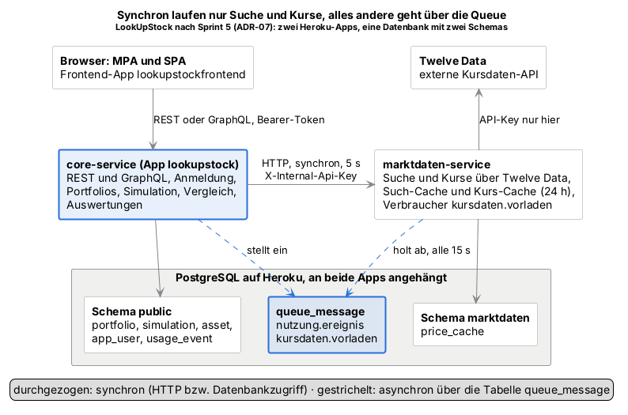

# 3 Implementierung: Architektur, getrennte Dienste, GraphQL

*Docs #175 · Paul Kaufmann (Paul02112004)*

Als wir LookUpStock geplant haben, war es eine ganz normale Spring-Boot-Anwendung mit einem Frontend davor. Fünf Sprints später besteht das Backend aus zwei Diensten, die sich eine Datenbank teilen und über eine Queue miteinander reden, und GraphQL kann ungefähr so viel wie REST. In diesem Kapitel erzählen wir, wie es dazu kam. Wir gehen dabei chronologisch vor, weil fast jede Entscheidung auf einer früheren aufbaut und einige erst durch einen Fehler oder eine Rückmeldung des Dozenten ausgelöst wurden.

Als Quellen dienen uns vor allem unsere Architekturentscheidungen ADR-01 bis ADR-07, die Pull Requests im Backend-Repository und unser KI-Log. Wie wir Twelve Data angebunden haben und wie Queue und Caches im Detail funktionieren, steht in Kapitel 4 „Integration von Twelve Data, Queue und Caches“. Die beiden Oberflächen behandelt Kapitel 5 „MPA und SPA“.

## 3.1 Ausgangslage: ein Backend mit drei Schichten

Im ersten Sprint haben wir uns in ADR-01 für eine klassische Drei-Schichten-Architektur entschieden: ein Frontend im Browser und dahinter ein einziges Spring-Boot-Backend mit Controllern, Services und Repositories. Microservices standen damals zwar zur Auswahl, wir haben sie aber bewusst verworfen. Mehrere Deployments, Kommunikation zwischen Diensten und verteilte Fehlerbehandlung schienen uns für vier Personen und acht Wochen schlicht zu viel.

Für den Anfang war das die richtige Wahl. Wir konnten Portfolios, Suche, Simulation und Vergleich parallel entwickeln, und die Kernlogik ließ sich ohne HTTP testen. Zwei kleine Entscheidungen aus dieser Zeit haben uns später viel Arbeit erspart. Zum einen liefen alle Kursdaten von Anfang an über die Schnittstelle MarketDataProvider, eigentlich nur, damit unsere Tests ohne Internet auskommen. Genau an dieser Stelle konnten wir in Sprint 5 die Twelve-Data-Anbindung herauslösen, ohne die Simulation anzufassen. Zum anderen koordinieren unsere Use-Case-Controller nur und rechnen nicht selbst. Deshalb ließ sich GraphQL später einfach neben REST stellen, ohne Fachlogik doppelt zu schreiben.

Der eigentliche Fehler lag woanders. Wir haben ADR-01 nie gegen die Vorgaben der Webprogrammierung geprüft, und die schließen monolithische Architekturen ausdrücklich aus. Aufgefallen ist uns das erst beim Abgleich im Sprint-Planning 5, also keine zwei Wochen vor der Abgabe. Heute würden wir die Bewertungskriterien beider Module gleich zu Projektbeginn als Anforderungen aufschreiben und jede Architekturentscheidung daran messen.

## 3.2 Vorarbeit: Anmeldung im Header (ADR-06)

Bevor wir das Backend aufteilen konnten, mussten wir eine frühere Entscheidung zurücknehmen. In ADR-04 hatten wir das Token im JSON-Body übertragen. Weil Browser bei GET keinen Body senden, liefen lesende Abfragen mit Anmeldung als POST auf eigene Pfade wie POST /portfolios/list. Wir haben in Sprint 4 gemerkt, dass das nicht REST-konform ist.

Mit ADR-06 haben wir das korrigiert. Das Token steht jetzt im Header Authorization: Bearer <token>, und aus POST /portfolios/list wurde wieder ein schlichtes GET /portfolios. Statt den Header in zehn Controller-Methoden einzeln auszulesen, haben wir einen eigenen HandlerMethodArgumentResolver geschrieben. Ein Controller schreibt einfach @CurrentUser User user in seine Parameter und bekommt den angemeldeten Nutzer geliefert (gekürzt):

```java
@Override
public User resolveArgument(MethodParameter parameter, ModelAndViewContainer mavContainer,
        NativeWebRequest webRequest, WebDataBinderFactory binderFactory) {
    String token = extractToken(webRequest.getHeader(HttpHeaders.AUTHORIZATION));
    if (token == null) {
        throw new UnauthorizedException(Messages.NOT_LOGGED_IN); // 401
    }
    return authService.getObject().authenticate(token);          // 401, wenn abgelaufen
}
```

Diese Klasse hat sich mehr gelohnt, als wir erwartet hatten. Ein neuer Endpunkt ist automatisch geschützt, sobald er den Parameter verlangt, eine vergessene Prüfung kann also nicht mehr passieren. Und als später GraphQL dazukam, konnte der GraphQL-Interceptor dieselbe Methode extractToken verwenden, sodass beide Schnittstellen nach exakt denselben Regeln prüfen.

Ganz glatt lief die Umstellung trotzdem nicht. Weil sich Pfade und Übertragung gleichzeitig änderten, gab es keine Übergangsphase: Backend (BE #91) und Frontend (FE #37) mussten im selben Moment gemergt und ausgeliefert werden, sonst hätte jede Anfrage mit 401 oder 404 geendet. Dazu kam ein eher peinlicher Fehler. Ein mehrzeiliges git commit -m in PowerShell hat uns einen völlig verstümmelten Commit-Titel beschert, den wir erst beim Squash-Merge reparieren konnten. Seitdem schreiben wir Commit-Nachrichten im Editor.

Im Rückblick war ADR-06 die richtige Entscheidung, aber eine, die wir uns hätten sparen können. Dass Browser bei GET keinen Body senden, wussten wir schon bei ADR-04. Statt daraus auf den Header zu schließen, haben wir mit POST-Pfaden um das Problem herumgebaut und es zwei Sprints später mit doppeltem Aufwand in Backend und Frontend wieder zurückgenommen.

## 3.3 Aufteilung in zwei Dienste (ADR-07)

In Sprint 5 stand dann die eigentliche Frage im Raum: Wo schneiden wir das Backend auf? Bevor wir eine Zeile Code angefasst haben, haben wir die Optionen in ADR-07 gegeneinander abgewogen. Ein Dienst pro Fachbereich hätte am saubersten ausgesehen, hätte aber sechs Deployments und verteilte Transaktionen zwischen Portfolio und Simulation bedeutet, und das in einer Woche. Die Simulation als eigenen Dienst herauszulösen klang zunächst verlockend, weil sie der rechenintensive Teil ist. Sie braucht aber Portfolios, Kurse und das Speichern, sodass am Ende drei Dienste hätten zusammenarbeiten müssen. Wir haben uns für zwei Dienste entschieden: den core-service mit allem Fachlichen und beiden Schnittstellen für das Frontend, und den marktdaten-service, der als einziger Twelve Data kennt. Der Preis dafür ist, dass die Simulation jetzt einen anderen Dienst fragen muss, bevor sie rechnen kann.



*Abbildung: Architektur nach Sprint 5 · 2 Dienste, 1 Datenbank, 2 Schemas*

Der Schnitt liegt genau dort, wo seit Sprint 1 die Schnittstelle MarketDataProvider war. Im core-service hat eine neue Klasse MarktdatenClient den alten TwelveDataProvider ersetzt und implementiert dieselbe Schnittstelle. Für den ParameterEstimator, die Suche und alle anderen Aufrufer hat sich dadurch nichts geändert. Das war für uns der greifbarste Moment, in dem ein GRASP-Prinzip aus der Vorlesung (Protected Variations) tatsächlich Arbeit gespart hat.

Etwas länger diskutiert haben wir, ob dieser Aufruf asynchron sein muss. Die Guidelines verlangen asynchrone Kommunikation zwischen Komponenten, lassen aber begründete Ausnahmen zu. Unsere Begründung: Eine Simulation mit 10.000 Pfaden kann erst loslegen, wenn die Kurse aller Anlagen da sind, und bei der Suche wartet der Nutzer ohnehin auf die Treffer. Eine Queue hätte hier nur Wartezeit erzeugt. Deshalb ruft der Core den marktdaten-service synchron per HTTP auf und wartet höchstens fünf Sekunden. Jeder Fehler wird wie früher zu 503 UPSTREAM_UNAVAILABLE, sodass das Frontend von der ganzen Aufteilung nichts merkt:

```java
@Override
public List<PricePoint> getHistoricalPrices(String symbol, String micCode, String interval, int outputSize) {
    try {
        List<PricePoint> prices = restClient.get()
                .uri(b -> b.path("/internal/prices").queryParam("symbol", symbol) /* … */ .build())
                .retrieve()
                .body(PRICE_POINTS);
        return prices == null ? List.of() : prices;
    } catch (RestClientResponseException e) {   // 401 oder 503 vom marktdaten-service
        throw failed("prices " + symbol, e);
    } catch (RestClientException e) {           // Timeout, Dienst nicht erreichbar
        throw unreachable("prices " + symbol, e);
    }
}
```

Ein Punkt, an den wir anfangs nicht gedacht hatten: Die „internen“ Endpunkte des marktdaten-service sind zwar nur für den Core gedacht, liegen aber als eigene Heroku-App offen im Internet. Ein Filter lässt deshalb nur Anfragen durch, die den gemeinsamen Schlüssel im Header X-Internal-Api-Key mitbringen. Fehlt der Schlüssel in der Konfiguration, wird alles abgewiesen, statt den Dienst versehentlich offen zu lassen. Verglichen wird mit MessageDigest.isEqual, damit die Antwortzeit nichts über den Schlüssel verrät.

Eine Sache haben wir bewusst nicht getrennt, nämlich die Datenbank. Eine zweite Heroku-Datenbank hätte zusätzliche Kosten und Konfiguration bedeutet, also teilen sich beide Dienste eine Datenbank mit zwei Schemas. Damit daraus keine versteckte Abhängigkeit wird, liest der marktdaten-service keine Tabelle des Core, sein Kurs-Cache arbeitet mit Symbol und MIC-Code statt mit der asset.id, und jeder Dienst führt seine eigene Flyway-Historie.

Würden wir die synchrone Ausnahme wieder so machen? Für die Simulation ja: Eine Simulation ohne Kurse kann nicht rechnen, und eine Queue hätte den Nutzer nur auf eine Antwort warten lassen, die ohnehin sofort gebraucht wird. Der Preis ist aber größer, als wir in ADR-07 aufgeschrieben haben. Der Core ist jetzt davon abhängig, dass ein zweiter Dienst läuft und der gemeinsame Schlüssel auf beiden Seiten stimmt; fällt eines davon aus, liefern Suche und Simulation 503, obwohl der Core selbst fehlerfrei ist. Wie viel Zeit der zusätzliche Aufruf kostet, haben wir nicht gemessen. Das wäre der erste Schritt, bevor wir an der Entscheidung etwas ändern.

## 3.4 Umsetzung und Betrieb: vom Ordner zur zweiten App

Den Umbau selbst haben wir in kleine Schritte zerlegt, die jeweils für sich gemergt und geprüft werden konnten. Zuerst kam ein reiner Verschiebe-PR (BE #105): Der gesamte Code wanderte mit git mv in den Ordner core-service/. Von 141 geänderten Dateien waren 140 reine Umbenennungen, nur der CI-Workflow bekam einen Pfadfilter. So konnte man den Umzug reviewen, ohne eine Zeile Code lesen zu müssen. Weil die App auf Heroku jetzt in einem Unterordner liegt, brauchte sie den Monorepo-Buildpack mit der Variable APP_BASE=core-service. Den haben wir unmittelbar vor dem Merge gesetzt, damit kein Build mit halb fertiger Konfiguration lief.

Beim zweiten Schritt, dem marktdaten-service (BE #106), war die Reihenfolge noch wichtiger. Sobald der neue Code auf main landet, fragt der Core für Suche und Kurse nur noch den marktdaten-service. Gäbe es den in diesem Moment nicht, würden Suche und Simulation online sofort mit 503 antworten. Wir haben die neue Heroku-App deshalb zuerst vom Feature-Branch aus deployt, im Log geprüft, dass Flyway das neue Schema angelegt hat, und erst gemergt, als der Health-Check „UP“ meldete. Aufgeräumt haben wir ganz zum Schluss: Die Migration V11, die die alte Tabelle price_history löscht, durfte erst nach den Migrationen V9 und V10 aus einem anderen Issue kommen, sonst hätte Flyway den Start wegen der Reihenfolge verweigert.

Die größten Probleme hatten wir ehrlicherweise nicht im Code, sondern rundherum. Beim Umzug ist uns aufgefallen, dass in der Datei .env.example seit dem ersten Sprint ein echter Twelve-Data-Key stand. Wir haben ihn ersetzt und die Vorlage bereinigt. Gelöscht ist er damit aber nicht, denn in der Git-Historie bleibt er sichtbar, und nur ein neuer Schlüssel macht den alten wertlos. Auf Heroku hat uns dann die Oberfläche Zeit gekostet. Die Buildpack-URL wurde erst mit der Endung .git akzeptiert, eine bestehende Datenbank ließ sich nur über die Heroku CLI an die zweite App hängen, und weil alle Apps im Account eines Teammitglieds lagen, mussten wir die Schritte an dessen Rechner erledigen. Dabei hieß die neue App nach zwei Tippfehlern zwischenzeitlich „lockupstock-markdaten“. Wir haben sie umbenannt, bevor ihr Name in Konfiguration und Doku landete.

Ein letzter Punkt betrifft unsere Arbeitsweise. Den Code für BE #106 bis #109 haben wir mit KI-Unterstützung erstellt (KI-Log Nr. 63 bis 66), und die KI konnte ihn in ihrer Umgebung nicht kompilieren. Wir haben deshalb vor jedem Push lokal alle Tests laufen lassen, nach dem letzten Umbau 302 im Core und 33 im marktdaten-service, alle grün. Ohne diese Tests hätten wir uns einen Umbau dieser Größe so kurz vor der Abgabe nicht getraut.

## 3.5 Asynchronität zwischen den Diensten: eine Lücke, die wir spät sahen

Nach dem Umzug waren wir zunächst zufrieden: zwei Dienste, eine Queue, alles läuft. Erst beim Durchgehen unserer offenen Issues gegen die Guidelines haben wir gemerkt, dass die Queue nur Teile des Core miteinander verband. Die Nutzungsereignisse für das Dashboard (Thema nutzung.ereignis) stellt der Core ein und verarbeitet sie auch selbst. Zwischen core-service und marktdaten-service lief dagegen alles synchron, also genau die Ausnahme, die eigentlich nur für die Kursabfrage gedacht war.

Dabei stand die Lösung schon in ADR-07, wir hatten sie nur nicht umgesetzt: ein zweites Thema namens kursdaten.vorladen. Legt jemand ein Portfolio an oder ändert es, stellt der Core Symbol und MIC-Code der Anlagen in die Queue und kümmert sich nicht weiter darum. Der marktdaten-service schaut alle 15 Sekunden nach, holt höchstens drei Nachrichten ab und lädt die fehlenden Monatswerte schon einmal in seinen Kurs-Cache. Simuliert der Nutzer danach zum ersten Mal, kann der Core die Kurse aus dem Cache bekommen, statt dass erst Twelve Data gefragt werden muss. Wie viel Zeit das tatsächlich spart, haben wir nicht gemessen. Ist das Vorladen noch nicht durch, läuft die Simulation einfach wie vorher über den synchronen Abruf. Die Nachricht enthält mit Absicht keine IDs aus dem Core, weil der marktdaten-service dessen Tabellen nicht kennen soll:

```json
{ "instruments": [ { "symbol": "URTH", "micCode": "ARCX" }, { "symbol": "IEMG", "micCode": "ARCX" } ] }
```

Dass das schnell ging, lag an der Queue, die ein Teammitglied in BE #114 gebaut hatte. Dank der Schnittstelle MessagePublisher ist ein neues Thema nur ein neuer Absender und ein neuer Verbraucher, an der Infrastruktur mussten wir nichts ändern. Wie die Queue-Tabelle und ihre Verbraucher im Detail arbeiten, beschreibt Kapitel 4. Für uns war die eigentliche Lehre eine andere: Eine Vorgabe ist nicht schon deshalb erfüllt, weil die passende Technik im Projekt vorhanden ist. Hätten wir zu jeder Vorgabe aufgeschrieben, welche konkrete Interaktion sie nachweist, wäre uns die Lücke schon beim Planen aufgefallen und nicht erst kurz vor Schluss.

## 3.6 GraphQL: von lesend zu vergleichbarem Umfang

GraphQL gab es bei uns seit Sprint 4, allerdings nur lesend (BE #94): Man konnte Anlagen suchen und die eigenen Portfolios und gespeicherten Simulationen abrufen. Die Guidelines bewerten GraphQL aber nach den „Funktionalitäten verglichen mit dem REST-Server“, und alles, was etwas verändert oder berechnet, ging nur über REST. In Sprint 5 haben wir deshalb sechs Mutations ergänzt (BE #108). Mit createPortfolio, updatePortfolio und deletePortfolio lassen sich Portfolios anlegen, ändern und löschen, simulate rechnet eine Simulation und speichert sie auf Wunsch, deleteSavedSimulation löscht eine gespeicherte Simulation, und compare führt einen Vergleich durch. Jede davon entspricht genau einem REST-Endpunkt.

„Vergleichbar“ haben wir dabei wörtlich genommen: dieselben Services, dieselben Prüfregeln und dieselben Fehlermeldungen wie bei REST. Der MutationController übersetzt nur. Er bindet die GraphQL-Eingaben an genau die Klassen, die bei REST den JSON-Body aufnehmen, und ruft dann dieselben Services auf. Die Simulation läuft dadurch Schritt für Schritt so ab wie im SimulationController:

```java
@MutationMapping
public SimulationResponse simulate(@Argument SimulationRequest input,
        @ContextValue(name = AuthTokenInterceptor.TOKEN_KEY, required = false) String token) {
    User user = currentUser(token);                // UNAUTHORIZED wie 401 bei REST
    String name = input.validatedName();           // Name vor dem Rechnen prüfen
    SimulationParameters parameters = input.parameters() == null
            ? null : input.parameters().toSimulationParameters();
    SimulationResult result = simulationService.simulate(input.portfolioId(), parameters, user);
    if (!input.shouldSave()) {
        return SimulationResponse.from(result);
    }
    SavedSimulation saved = savedSimulationService.save(result, name, user);
    return SimulationResponse.from(saved, savedSimulationService.readResult(saved));
}
```

Über drei Details haben wir länger nachgedacht. Das erste waren die Pflichtfelder. Hätten wir im Schema name: String! geschrieben, hätte GraphQL einen fehlenden Namen selbst abgelehnt, mit einer englischen Standardmeldung, die das Frontend nicht anzeigen kann. Wir haben die Eingabefelder deshalb absichtlich optional gelassen, damit unsere eigenen Prüfregeln greifen und dieselben deutschen Meldungen zurückkommen wie bei REST.

Das zweite war eine kleine Überraschung: Der GraphQL-Typ Int kann nur 32 Bit, unser seed ist aber ein long. Wir haben ihn als Float typisiert, was bis 2^53 exakt ist, und das im Schema dazugeschrieben. Ein eigener Datentyp wäre eleganter gewesen, hätte aber eine zusätzliche Bibliothek gebraucht, und dafür fehlte uns die Zeit. Ehrlich betrachtet ist das eine Notlösung. Kommazahlen wie 42.5 lehnt die bestehende Prüfung zwar ab wie bei REST, aber ein Seed oberhalb von 2^53 würde stillschweigend gerundet, und die Simulation liefe mit einem anderen Seed als dem eingegebenen. Praktisch tritt das bei uns nicht auf, weil das System selbst nur Seeds unter einer Million erzeugt. In einem länger laufenden Projekt würden wir den eigenen Datentyp trotzdem nachziehen.

Das dritte betraf die Fehler. GraphQL antwortet auch im Fehlerfall mit Status 200, es gibt also kein 400 oder 422, an dem ein Client etwas erkennen könnte. Wir legen den Fehlercode wie VALIDATION_ERROR oder INSUFFICIENT_DATA und die Einzelfehler deshalb in das Feld extensions, sodass ein Client sie genauso auswerten kann wie error.code und error.details bei REST.

Ganz deckungsgleich sind die beiden Schnittstellen trotzdem nicht. Registrieren, Anmelden, den Gastmodus und die Auswertungen für die Geschäftsführung gibt es nur über REST. Statt das zu verschweigen, haben wir es im API-Design ausdrücklich festgehalten. Abgesichert sind die Mutations durch zehn Tests, die unter anderem prüfen, ob die Eingaben richtig ankommen, ob fremde Portfolios als NOT_FOUND gemeldet werden und was bei zu kurzer Kurshistorie passiert.

## 3.7 Fazit: was wir wieder so und was wir anders machen würden

Wenn wir zurückblicken, hat sich die Architektur in der letzten Woche grundlegend verändert, ohne dass wir Kernlogik oder Tests umbauen mussten. Das lag weniger an dieser Woche als an Entscheidungen, die wir Wochen vorher getroffen hatten, oft ohne zu ahnen, wofür sie einmal gut sein würden.

Genauso machen würden wir es wieder, Entscheidungen vor dem Code als ADR festzuhalten, mit Alternativen und Folgen. Bei ADR-07 hat uns das vor einem überdimensionierten Schnitt bewahrt. Auch Schnittstellen wie MarketDataProvider und MessagePublisher würden wir wieder einführen, selbst wenn es anfangs nur eine einzige Umsetzung gibt. Große Umbauten würden wir wieder in kleine, einzeln gemergte Schritte zerlegen, neue Infrastruktur erst vom Branch aus testen und eine zweite Schnittstelle wie GraphQL nur übersetzen lassen, statt Logik zu kopieren.

Anders machen würden wir vor allem den Anfang. Die Bewertungskriterien beider Module gehören gleich zu Projektbeginn in die Anforderungen, und zu jeder Vorgabe sollte feststehen, durch welche konkrete Interaktion sie nachgewiesen wird. Schlüssel würden wir von Anfang an nur in Konfigurationsvariablen ablegen und nie in Beispieldateien. Direkte Pushes auf main hätten wir früher unterbinden sollen; in die Definition of Done kam die Regel erst in Sprint 5. Und den Zugang zu Heroku hätten wir von Beginn an für alle im Team einrichten sollen, statt am Ende auf einen einzigen Rechner angewiesen zu sein.

Eine offene Baustelle bleibt die gemeinsame Datenbank. Für zwei Dienste im kostenlosen Rahmen war sie die vernünftige Lösung, aber sie ist eine bewusste Kopplung. Würde das Projekt weiterwachsen, wäre eine eigene Datenbank für den marktdaten-service der nächste Schritt.

